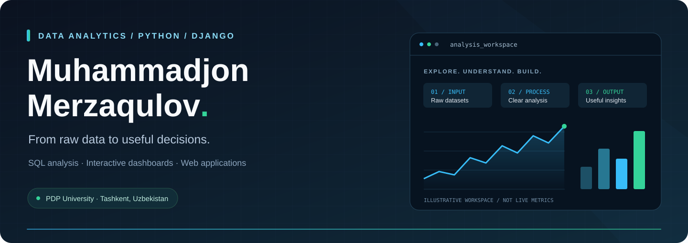
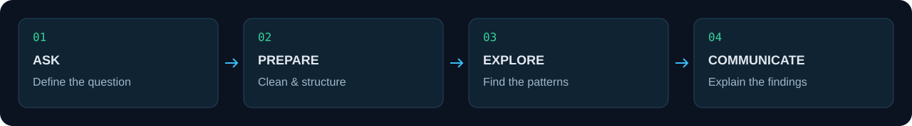

  

<h1 align="center">Hi, I'm Muhammadjon 👋</h1>

  <strong>Software Engineer · Data Analytics · Python &amp; Django</strong> 
  Tashkent Branch of MUCTR · Data Analytics student at PDP University  
  I work with data to find patterns, explain business performance, and build useful tools. 
  My projects span SQL analysis, Power BI dashboards, data cleaning, and web applications.

  <a href="#-selected-projects">Selected projects</a> &nbsp;·&nbsp;
  <a href="#-toolkit">Toolkit</a> &nbsp;·&nbsp;
  <a href="#-learning--exploration">Learning</a> &nbsp;·&nbsp;
  <a href="#-lets-connect">Connect</a>

  
  
  

---

## 🧭 About me

I'm Muhammadjon Merzaqulov, a Software Engineer at the Tashkent Branch of MUCTR (Mendeleev University of Chemical Technology of Russia) and a Data Analytics student at PDP University. Based in Tashkent, Uzbekistan, I enjoy connecting analytical work with practical software development.

- **Data preparation:** clean inconsistent values, handle missing data, standardize formats, and combine datasets with Python, Pandas, and NumPy.
- **Analysis:** use SQL to investigate sales trends, product performance, profitability, and differences across locations.
- **Visualization:** build Power BI reports with interactive filters, data relationships, and DAX measures.
- **Application development:** work with Django and PostgreSQL to build tools with authentication, user roles, and business workflows.
- **Exploration:** study machine learning and data engineering through notebooks, database exercises, and applied projects.

I enjoy the full journey: understanding a question, preparing the data, exploring the evidence, and presenting something people can use.

## 🧰 Toolkit

**Data analysis &amp; business intelligence**

  
  
  
  
  
  

**Backend &amp; databases**

  
  
  

**Tools used in application projects**

  
  
  
  

## ✨ Selected projects

### 01 · SQL Sales Analysis

**[Truck SQL EDA Project →](https://github.com/muhammadjon-merzaqulov/Truck_SQL_EDA_Project)**

An exploration of a vehicle sales database, covering sales trends, profitable periods, location performance, and top-selling models. The analysis also examines safety ratings, fuel types, and warranty periods.

`SQL` `Exploratory Data Analysis` `Business Analysis`

[Explore the SQL queries](https://github.com/muhammadjon-merzaqulov/Truck_SQL_EDA_Project/blob/main/Truck_Analysis.sql) · [Read the analysis PDF](https://github.com/muhammadjon-merzaqulov/Truck_SQL_EDA_Project/blob/main/Truck_Analysis_SQL.pdf)

### 02 · BMW Sales Dashboard

**[Car Sales Dashboard →](https://github.com/muhammadjon-merzaqulov/Car_Sales_Dashboard)**

A Power BI report for exploring sales data through interactive visuals, filters, and slicers. Includes data relationships and DAX measures to support deeper analysis.

`Power BI` `DAX` `Data Visualization`

[View the Power BI project file](https://github.com/muhammadjon-merzaqulov/Car_Sales_Dashboard/blob/main/BMW_sales_dashbord_BI.pbix)

### 03 · Customer Data Cleaning

**[NumPy & Pandas Data Cleaning →](https://github.com/muhammadjon-merzaqulov/Numpy-Pandas-Data-Cleaning)**

Preparation and merging of three customer datasets. The project addresses inconsistent names, gender values, ages, emails, and cities, standardizes formats, and handles missing values before combining the data.

`Python` `Pandas` `NumPy` `Data Quality`

### 04 · AttendAI

**[Face-Based Attendance System →](https://github.com/muhammadjon-merzaqulov/face-based-attendance-system)**

A Django attendance application that uses DeepFace with ArcFace for face verification. Features separate admin, teacher, and student roles, QR/PIN attendance sessions, and background processing with Celery and Redis. The repository includes a Docker Compose setup with PostgreSQL and Nginx.

`Django` `Computer Vision` `PostgreSQL` `Celery` `Docker`

### 05 · Containerized CRM

**[CRM Django Project →](https://github.com/muhammadjon-merzaqulov/CRM-Django-project)**

A Django CRM project with modules for contacts, leads, deals, and tasks. Its cloud computing assignment documents a Docker Compose setup, a separate PostgreSQL service, and persistent database storage.

`Python` `Django` `PostgreSQL` `Docker Compose`

### 06 · Applied Machine Learning

**[Applied Models →](https://github.com/muhammadjon-merzaqulov/applied_models)**

Supervised and unsupervised learning notebooks exploring Gen Z health scores and behavior, accompanied by a project report.

`Machine Learning` `Jupyter` `Supervised Learning` `Unsupervised Learning`

  
<strong>More projects &amp; practice</strong>

- **[NewEra Cash & Carry](https://github.com/muhammadjon-merzaqulov/NewEra-Cash-Carry)** — a Python and SQLite store management project with customer, admin, and superadmin roles.
- **[Django Task Application](https://github.com/muhammadjon-merzaqulov/Django_project)** — task management with authentication and task creation, editing, and deletion.
- **[Django News Website](https://github.com/muhammadjon-merzaqulov/News_Website_django)** — a news application with categorized content and an admin interface.
- **[Data Engineering Practice](https://github.com/muhammadjon-merzaqulov/pdp-4-data-engineering)** — PostgreSQL exercises, including a banking data warehouse case study.

## 🔎 My approach to analysis

  

1. **Start with the question.** Define what needs to be understood and which metrics matter.
2. **Prepare the data.** Check types, missing values, duplicates, and consistency before analysis.
3. **Explore the evidence.** Compare trends, segments, and relationships with SQL and Python.
4. **Make it understandable.** Present findings through readable queries, notebooks, reports, and dashboards.

## 🌱 Learning & exploration

- **Machine learning:** practicing supervised and unsupervised approaches through applied notebooks.
- **Data engineering:** working through PostgreSQL and data warehouse exercises.
- **Data visualization:** improving how reports communicate patterns and business questions.
- **Application infrastructure:** connecting Django applications with databases, task queues, and containers.

## 📈 GitHub activity

[Browse my repositories](https://github.com/muhammadjon-merzaqulov?tab=repositories) · [View my contribution history](https://github.com/muhammadjon-merzaqulov?tab=overview)

  
<strong>Show live statistics &amp; contribution graph</strong>

   
  

    
    
  

  

    
  

  
Live cards are provided by external services and may occasionally be unavailable. Language charts reflect repository contents.

## 🤝 Let's connect

Interested in data analysis, dashboards, Python, or Django? Feel free to reach out about a project or an idea.

- **Email:** [mail@muhammadjon.uz](mailto:mail@muhammadjon.uz)
- **Telegram:** [@merzaqulov1](https://t.me/merzaqulov1)
- **LinkedIn:** [Muhammadjon Merzaqulov](https://www.linkedin.com/in/muhammadjon-merzaqulov/)
- **LeetCode:** [muhammadjon-merzaqulov](https://leetcode.com/u/muhammadjon-merzaqulov/)

---

  <strong>From raw data to useful decisions.</strong> 
  Thanks for visiting — explore the projects, read the analysis, and follow along.

